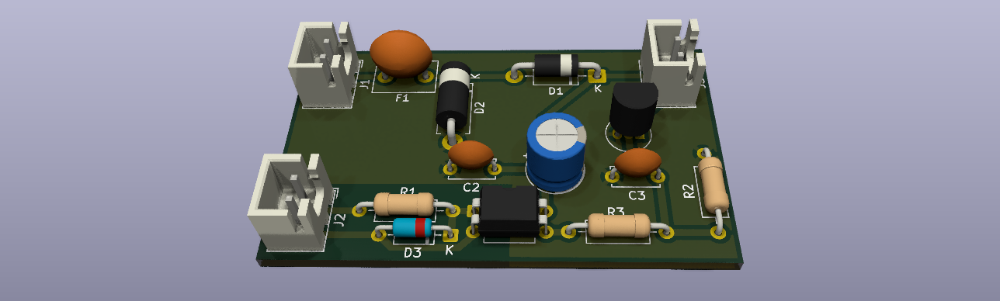

# A1 mini LED strip follower

 
A small add-on board that drives an external 24 V LED strip on the Bambu Lab A1 mini.
The strip turns on and off together with the printer's built-in light, so you control it
from the printer screen, Bambu Studio or Bambu Handy.
 
## How it works
 
- **Power:** 24 V from the printer's spare AMS port, through a resettable fuse, TVS clamp and reverse-polarity diode.
- **Sense:** two wires soldered to the legs of one built-in LED in the camera module drive a PC817 optocoupler, keeping the printer's LED circuit isolated from the 24 V side.
- **Switch:** the optocoupler turns on a MOSFET that switches the strip's negative wire. The strip is off at power-up.

See KiCad sources in this repo for the full schematic.
 
## Building it
 
1. Measure the voltage across one built-in LED with the light on, then set R1 = (V − 1.2 V) / 2 mA (about 1 kΩ for 3 V).
2. Measure your strip's current and pick F1 with a hold current of about twice that, rated for at least 30 V.
3. Check the AMS cable's pinout with a multimeter. Only +24 V and GND are used; leave the data pins unconnected.
4. Solder the twisted-pair tap to one LED's legs, route it out of the camera module with strain relief, and test before closing everything up.

I designed the PCB for through-hole parts, the BOM is in the schematic. Assembled PCB should more or less fit behind the camera module access cover.
 
## ⚠️ Disclaimer
 
This modification opens the printer and solders to the camera board. It voids your warranty,
and a mistake can damage the printer. Do it at your own risk.
 
Not affiliated with or endorsed by Bambu Lab. "Bambu Lab" and "A1 mini" are trademarks of their owner
and are used here only to describe compatibility.
 
## License
 
[MIT](LICENSE)
